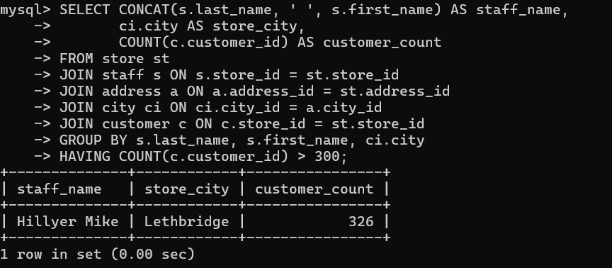
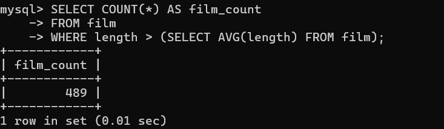
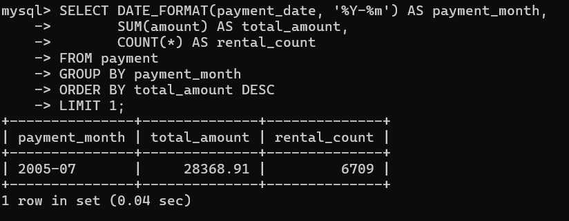

# Домашнее задание к занятию "`SQL. Часть 2`" - `Павлова Алена`


### Задание 1

```
SELECT CONCAT(s.last_name, ' ', s.first_name) AS staff_name, 
       ci.city AS store_city, 
       COUNT(c.customer_id) AS customer_count
FROM store st
JOIN staff s ON s.store_id = st.store_id
JOIN address a ON a.address_id = st.address_id
JOIN city ci ON ci.city_id = a.city_id
JOIN customer c ON c.store_id = st.store_id
GROUP BY s.last_name, s.first_name, ci.city
HAVING COUNT(c.customer_id) > 300;
```




---

### Задание 2

```
SELECT COUNT(*) AS film_count
FROM film
WHERE length > (SELECT AVG(length) FROM film);
```




---

### Задание 3

```
SELECT DATE_FORMAT(payment_date, '%Y-%m') AS payment_month, 
       SUM(amount) AS total_amount, 
       COUNT(*) AS rental_count
FROM payment
GROUP BY payment_month
ORDER BY total_amount DESC
LIMIT 1;
```



